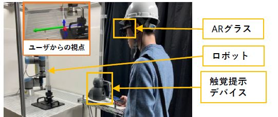
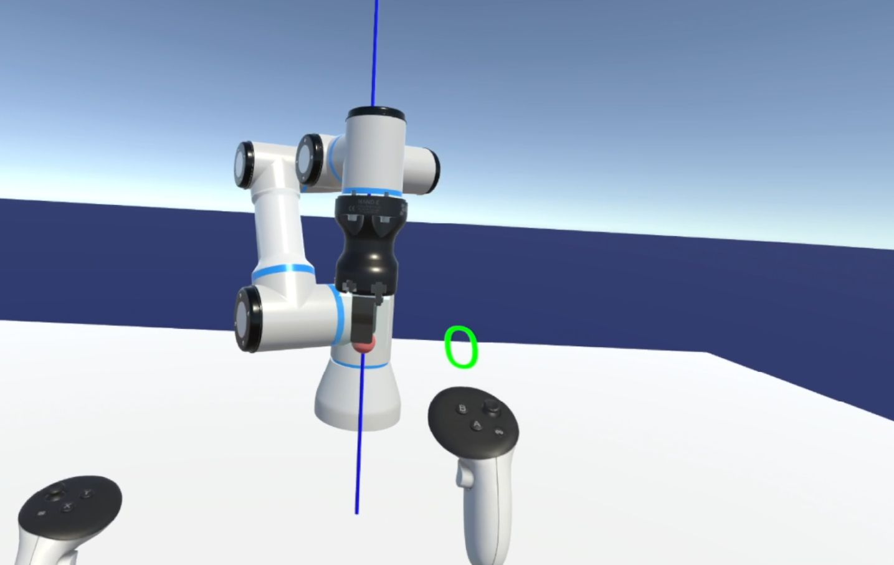
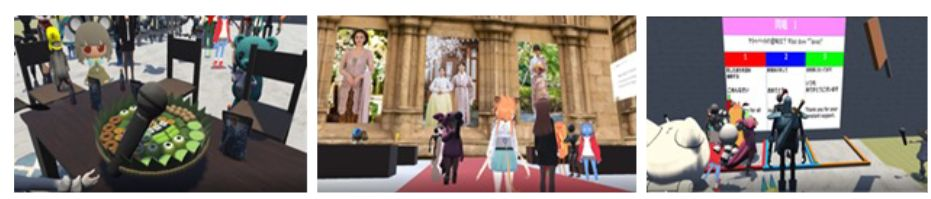

---
title: "Home"
lang: en
title-block-banner: false
page-layout: full
---

::: {.profile-container}

::: {.profile-image}

:::

::: {.profile-info}

# Manato Abe

**Ph.D. Student | Tohoku University**

Research Institute of Electrical Communication, Tohoku University

Human-Computer Interaction · Extended Reality · Human-Robot Interaction

[GitHub](https://github.com/ManatoABE)

:::

:::

::: {.home-content}

## About Me

I am a Ph.D. student at Tohoku University, Japan.

My research focuses on Human-Computer Interaction (HCI), Extended Reality (XR), and Human-Robot Interaction (HRI).

I am particularly interested in developing intuitive interfaces that support precise manipulation tasks in virtual and robotic environments.

## Research Interests

- Human-Computer Interaction (HCI)
- Virtual Reality (VR) / Augmented Reality (AR)
- Human-Robot Interaction (HRI)
- 3D User Interfaces
- Haptic Feedback

## Selected Research

::: {.research-list}

::: {.research-card}

{.research-thumbnail}

::: {.research-card-content}

### Visual and Haptic Feedback for Robot Manipulation

Supporting precise robot-arm manipulation through force-based visual and haptic feedback.

[Paper](https://doi.org/10.3389/frvir.2026.1808161)

:::

:::

::: {.research-card}

{.research-thumbnail}

::: {.research-card-content}

### Precise 3D Manipulation in VR

Exploring interaction techniques for accurate and intuitive 3D object manipulation.

:::

:::

::: {.research-card}

{.research-thumbnail}

::: {.research-card-content}

### VR for Education

Supporting interactive VR world creation for international virtual exchange education.

[Paper](https://library.apsce.net/index.php/ICCE/article/view/6075)

:::

:::

:::

:::
