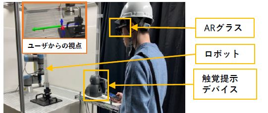
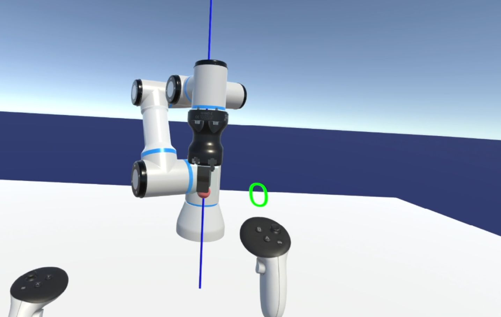
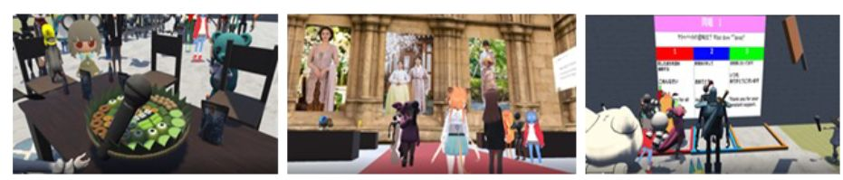

---
title: "ホーム"
lang: ja
title-block-banner: false
page-layout: full
---

::: {.profile-container}

::: {.profile-image}

:::

::: {.profile-info}

# Manato Abe

**Ph.D. Student | Tohoku University**

Research Institute of Electrical Communication, Tohoku University

Human-Computer Interaction · Extended Reality · Human-Robot Interaction

[GitHub](https://github.com/ManatoABE)

:::

:::

::: {.home-content}

## 自己紹介

東北大学の博士課程に在籍しています．

ヒューマンコンピュータインタラクション（HCI），XR，ヒューマンロボットインタラクション（HRI）を中心に研究しています．

特に，仮想環境やロボット操作における，直感的かつ精密な操作を支援するユーザインタフェースに関心があります．

## 研究分野

- ヒューマンコンピュータインタラクション（HCI）
- バーチャルリアリティ（VR）・拡張現実（AR）
- ヒューマンロボットインタラクション（HRI）
- 3Dユーザインタフェース
- 触覚フィードバック

## Selected Research

::: {.research-list}

::: {.research-card}

{.research-thumbnail}

::: {.research-card-content}

### Visual and Haptic Feedback for Robot Manipulation

Supporting precise robot-arm manipulation through force-based visual and haptic feedback.

[Paper](https://doi.org/10.3389/frvir.2026.1808161)

:::

:::

::: {.research-card}

{.research-thumbnail}

::: {.research-card-content}

### Precise 3D Manipulation in VR

Exploring interaction techniques for accurate and intuitive 3D object manipulation.

:::

:::

::: {.research-card}

{.research-thumbnail}

::: {.research-card-content}

### VR for Education

Supporting interactive VR world creation for international virtual exchange education.

[Paper](https://library.apsce.net/index.php/ICCE/article/view/6075)

:::

:::

:::

